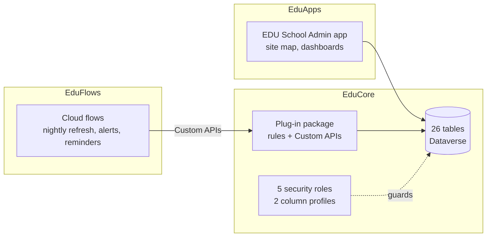
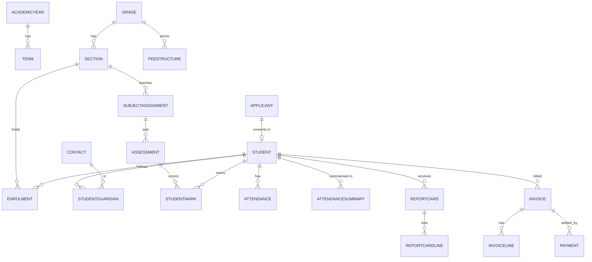

# Architecture

## Solutions and layers

## Data model (core relationships)

## Business logic placement
| Concern | Where | Why |
|---|---|---|
| Rules that must block a save (clashes, marks, status machine, money totals, immutability) | Synchronous plug-ins; the rule is a pure class with unit tests | Transactional and testable without Dataverse |
| Multi-record atomic operations | Custom APIs `edu_EnrolApplicant`, `edu_GenerateInvoice`, `edu_GenerateReportCards`, `edu_RefreshAttendanceSummary` | One transaction, callable from flows and buttons |
| Time-based and notification work | Cloud flows (overdue, reminders, low-attendance alert) | Needs connectors and a schedule |
| Access | Roles, teams, column profiles, auditing | See `docs/phase9.md` |

## Delivery
Source-controlled unpacked solutions, built and tested by `scripts/build.ps1` and the Azure DevOps pipeline (build, test, pack, solution checker, then TEST, UAT, PROD with managed solutions and per-environment settings files). See `docs/conventions.md`.
